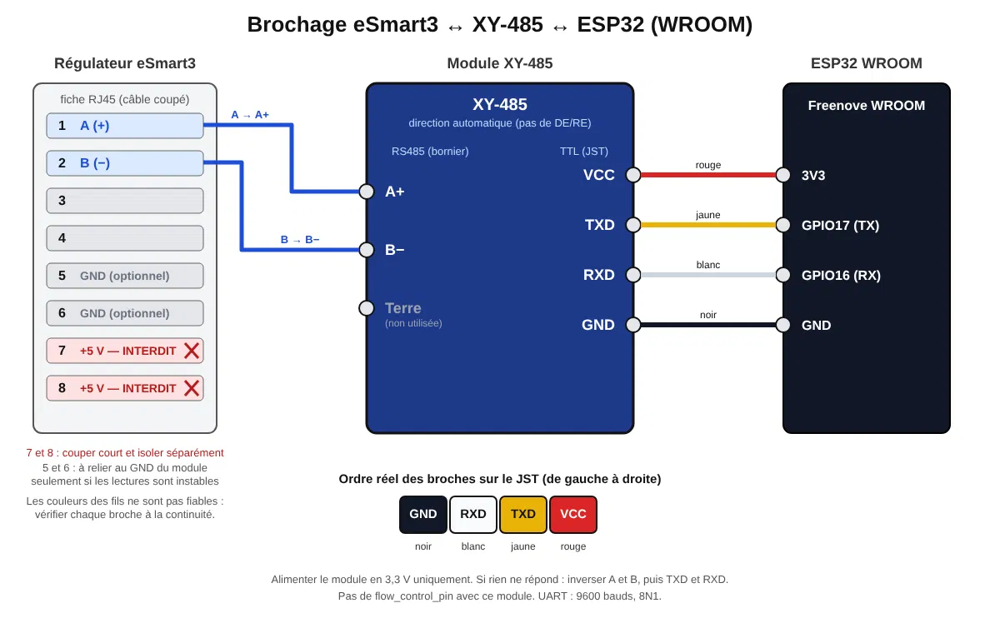

# esphome-esmart3

Composant ESPHome pour le régulateur solaire **eSmart3 MPPT** (Supower / Yueqing, version 40 A),
lu par son port RJ45 RS485. Il remplace le composant `esmart3` de ssieb, dont il reprend l'idée
en corrigeant ses défauts et en ajoutant ce que le protocole permet.

> **Statut de vérification** (à lire avant de flasher)
>
> | Élément | État |
> |---|---|
> | Couche protocole (trames, checksums, décodage, lecteur) | **Testée** : 69 vérifications `g++` (ASan/UBSan) dont les exemples du PDF constructeur |
> | Logique du composant (file de requêtes, timeouts, NACK, interrupteur) | **Simulée** : 93 vérifications contre de fausses en-têtes ESPHome (UART et horloge scriptées) |
> | Conformité à l'API ESPHome réelle (Python + C++) | **Validée et compilée** sous ESPHome 2026.10.0 (ESP-IDF 5.5.6, ESP32) : compilation réussie, firmware généré |
> | Matériel réel | **Jamais testé** (aucune trame échangée avec un vrai régulateur) |
>
> Le composant a été écrit sans pouvoir installer ESPHome (PyPI bloqué dans l'environnement de rédaction) ; la
> première compilation réelle a été faite sur l'add-on ESPHome de l'utilisateur. Reste à faire : brancher, lire les
> journaux (`logger: level: VERY_VERBOSE`) et vérifier les points de la section « Points à vérifier ».
>
## Câblage

Port RJ45 du régulateur (source : revue skagmo.com, confirmée par la lib E-t0m) :

| Broche RJ45 | Fonction |
|---|---|
| 1 | RS485 A (+) |
| 2 | RS485 B (−) |
| 5, 6 | GND |
| 7, 8 | +5 V en sortie (courant disponible inconnu — ne pas y brancher l'ESP32 sans le vérifier) |



*Montage de l'auteur : module XY-485 (direction automatique) et ESP32 WROOM. Source du schéma : [`boitier3d/brochage_esmart3_xy485_esp32.svg`](boitier3d/brochage_esmart3_xy485_esp32.svg).*

Vers l'ESP32 : un module RS485 ↔ TTL, `TX → GPIO17` (DI), `RX → GPIO16` (RO), modifiables. À savoir :

* **Module à direction automatique** : rien d'autre à câbler ni à configurer.
* **Module sans direction automatique** (DE/RE ou « RSE » exposé, comme la carte Waveshare RS485 Board, SP485/SP3485) :
  reliez cette broche à un GPIO libre et déclarez-le avec `flow_control_pin` (voir l'exemple). Le composant la
  met à HIGH avant d'émettre, attend la fin de l'envoi, puis la remet à LOW pour écouter la réponse. Sans cette
  option, **rien n'est émis**. Si DE et RE sont séparés, reliez-les ensemble.
* **Niveaux logiques** : les GPIO de l'ESP32 sont en 3,3 V et **ne tolèrent pas 5 V**, même si la carte ESP32 est
  alimentée en 5 V. Préférez un module en **3,3 V** (SP3485/MAX3485). Avec un module 5 V (SP485/MAX485), la sortie
  RO (vers le RX de l'ESP32) sort à ~5 V : intercalez un pont diviseur (1 kΩ en série, puis 2 kΩ du GPIO vers GND).
  Côté bus, rien à adapter : la liaison A/B est différentielle.
* **Débranchez le Cloud Box M2.** Deux maîtres sur le même bus se télescopent. (Le composant sait
  profiter de ses réponses s'il reste branché, mais les collisions rendent les lectures aléatoires.)
* Le 5 V du port RJ45 : des retours contradictoires existent sur sa capacité à alimenter un ESP32 avec le Wi-Fi
  (la lib Joba le juge trop faible). Vérifiez avant de vous y fier.
* Liaison fixée à **9600 bauds, 8N1** ; une autre valeur de `uart:` est refusée à la validation.

## Installation

```yaml
external_components:
  - source:
      type: local
      path: components      # chemin vers ce dépôt
    components: [esmart3]
```

Voir `examples/esmart3.yaml` pour une configuration complète (capteurs, textes, binaires).

### Test de compilation (add-on ESPHome Builder)

`examples/esmart3-test.yaml` est la version de test : tous les réglages (noms, pins, intervalles, secrets) sont en
`substitutions:` en tête de fichier, et le composant est chargé directement depuis GitHub :

```yaml
external_components:
  - source: github://patmtp35/Esphome_Esmart3@main
    components: [esmart3]
    refresh: 0s   # re-télécharge à chaque compilation pendant la mise au point
```

Collez-la dans l'add-on, renseignez les secrets (`api_key`, `ota_password`, `wifi_ssid`, `wifi_password`, et pour l'IP fixe `ip_esmart3`, `ip_gateway`, `ip_dns`), puis
**Valider** et **Installer → Télécharger manuellement** pour compiler sans flasher.

Le fichier active aussi l'interface web version 3 (`web_server`, fichiers embarqués avec `local: true`, accessible sur `http://<IP>`) et une IP fixe. Ces deux ajouts n'étaient pas dans la compilation de référence ci-dessous et n'ont pas été recompilés.

Résultat obtenu : compilation réussie sous **ESPHome 2026.10.0** (ESP-IDF 5.5.6, ESP32, module WROOM) ; firmware
d'environ 720 Ko, soit 39 % de la partition, RAM utilisée 25 %. Aucun flash ni test sur matériel à ce jour.
`examples/esmart3.yaml` reste la version à chemin local (`../components`), pour un dépôt cloné.

## Entités

| Plateforme | Clé | Contenu |
|---|---|---|
| `sensor` | `pv_voltage`, `battery_voltage`, `charging_current`, `load_voltage`, `load_current`, `charging_power`, `load_power` | mesures temps réel (V, A, W) |
| `sensor` | `battery_temperature`, `internal_temperature` | °C, **signées** (négatif correct) |
| `sensor` | `battery_level` | SOC en %, calculé par le régulateur |
| `sensor` | `charge_mode`, `fault_code` | codes bruts (diagnostic) |
| `sensor` | `energy_today`, `energy_month`, `energy_total` | production en kWh |
| `sensor` | `load_energy_today`, `load_energy_month`, `load_energy_total` | consommation de la sortie charge en kWh |
| `text_sensor` | `charge_mode` | Standby / MPPT / Bulk / Float / Pre-charge |
| `text_sensor` | `faults` | défauts décodés, `OK` si aucun |
| `text_sensor` | `load_mode` | mode configuré de la sortie charge |
| `binary_sensor` | `load_on` | sortie charge active |
| `binary_sensor` | `fault` | au moins un défaut |
| `switch` | `load` | *optionnel, voir plus bas* |

Les énergies sont lues 1 fois sur `slow_update_every` interrogations (6 par défaut, soit 60 s avec
`update_interval: 10s`). Si le régulateur ne répond plus pendant ~6 requêtes, les capteurs numériques
passent à `NaN` au lieu de rester figés sur une valeur périmée.

## Différences avec le composant ssieb

* Températures lues en **signé** (`int16`, comme dans le PDF). ssieb les lit en non signé : −2 °C devient 65534.
* Lecture de `wFault` (code défaut), des **énergies** jour/mois/total et de l'**état de la sortie charge**.
* Requêtes **une à la fois** avec file d'attente, délai de réponse et resynchronisation sur `0xAA`.
* Tolère l'**écho** de TX sur RX (certains modules RS485 rebouclent) : seules les réponses sont décodées.
* Aucune écriture au démarrage, aucune écriture sans action explicite de l'utilisateur.

## Points à vérifier sur votre matériel

1. **Ordre des mots des entiers 32 bits (énergies).** Le PDF se contredit : le texte dit « mot bas
   en premier », mais sa structure `Uint32s { wHi16; wLow16 }` et son exemple (`123456789` → `5B 07 15 CD`)
   placent le **mot haut en premier**. C'est le défaut (`u32_word_order: high_first`). Si
   `energy_today` affiche des valeurs énormes, passez à `low_first`.
2. **Numérotation des bits de défaut.** Le tableau 9-1 du PDF ne précise pas la numérotation. Le composant
   prend le premier défaut pour le bit 0, ce que confirment les masques `0x001`…`0x200` de la lib
   [joba-1/Joba_ESmart3](https://github.com/joba-1/Joba_ESmart3) (même liste, même ordre). Le code brut reste
   disponible (`fault_code`).
3. **Longueur de lecture.** Le composant demande 30 octets (jusqu'à `wFault`), comme la lib E-t0m ; la lib
   Joba lit la structure entière (32 octets) sans problème signalé.
   Si le régulateur refuse (NACK) 3 fois de suite, il se replie sur 24 octets (lecture de ssieb) et
   `fault_code` n'est plus disponible.
4. **Précision des mesures.** D'après la revue de skagmo (unité de 2019, pas forcément la vôtre) :
   tension affichée ~10 % trop basse, courant ~1,5 A trop bas, courant et puissance **PV inventés** par
   le firmware (puissance batterie + 1 %), SOC calculé sur la tension seule. C'est pourquoi aucune entité
   « puissance PV » n'est exposée. Comparez avec un multimètre et corrigez avec `filters:` côté ESPHome.
5. **Les énergies** reposent sur ces mêmes mesures côté batterie : utilisez-les pour des tendances,
   pas pour de la comptabilité.

## Interrupteur de la sortie charge (optionnel, non testé)

```yaml
switch:
  - platform: esmart3
    esmart3_id: esmart3_hub
    load:
      name: "eSmart3 Sortie charge"
```

À activer en connaissance de cause :

* Il **écrit `wLoadModuleSelect1`** dans le régulateur : `5117` (toujours ON) ou `5118` (toujours OFF).
  Cela **remplace le mode configuré** (minuterie, commande par la lumière…). Relevez d'abord votre mode actuel
  avec l'entité `load_mode`. Le composant ne sait pas le restaurer.
* Le sens de 5117/5118 vient des trames `LOAD_ON`/`LOAD_OFF` de la lib E-t0m ; le PDF ne les nomme que
  « Normally open/close state », ambigu. Vérifiez sur banc avec une charge sans conséquence.
* La lib Joba écrit exactement les mêmes valeurs (5117/5118, item 4, offset 1) et ne sauvegarde pas non plus
  le mode précédent. Elle précise que la commande par minuterie ou par la lumière n'est pas gérée par `setLoad`.
* On ignore si le régulateur mémorise ce réglage en flash : **n'automatisez pas de basculements fréquents**.
* Le commutateur n'est **jamais restauré au démarrage** et affiche l'état réellement relu après l'écriture.

Les paramètres de batterie (item 1), de protection (item 7) et de calibration (item 3) ne sont **volontairement
pas écrits** par ce composant.

## Protocole (résumé)

Trame : `AA | type | adresse | cmd | item | longueur | données | checksum`, mots en little-endian,
`checksum = (0 − somme des octets précédents) & 0xFF`.

| Lecture | Requête émise (adresse 0) | Mots lus |
|---|---|---|
| État temps réel (item 0) | `AA 01 00 01 00 03 00 00 1E 33` | 0x00–0x0E |
| Énergies (item 2) | `AA 01 00 01 02 03 06 00 20 29` | 0x06–0x15 |
| Sortie charge (item 4) | `AA 01 00 01 04 03 01 00 1E 2E` | 0x01–0x0F |

La réponse à un GET porte la commande `0x03` (`CMD_SET_NO_RESP`), avec en tête de données le mot d'offset.
Le PDF complet est dans `docs/esmart3-serial-comm.pdf`. Le code de référence est `components/esmart3/esmart3_protocol.h`.

## Tests

```sh
make -C tests test
```

Deux suites, compilées avec `g++` sous ASan/UBSan, sans ESPHome ni matériel :

* `test_protocol` : les requêtes du PDF et de E-t0m octet pour octet, la réponse temps réel du PDF
  (checksum `0x90`), les températures négatives, l'exemple 32 bits, un flux bruité (parasites, mauvais
  checksum, écho, trame coupée).
* `test_hub` : le composant complet (`esmart3.cpp`) contre de **fausses** en-têtes ESPHome (`tests/stubs`,
  écrites d'après l'API telle que je la connais, donc pas une preuve de compatibilité) : cycle normal,
  écho ignoré, broche DE/RE, 6 timeouts → `NaN` puis reprise, repli sur 24 octets après 3 NACK, abandon d'une lecture
  optionnelle refusée, interrupteur (écriture, ACK, NACK, timeout), tampon partiel.

## Dépannage

| Symptôme | Piste |
|---|---|
| `No response to request for item 0` | câblage A/B (essayez de les inverser), GND, module sans direction automatique et `flow_control_pin` absent, Cloud Box encore branché |
| Valeurs de températures absurdes | sonde externe absente : la valeur renvoyée par le régulateur dépend du firmware |
| Énergies énormes | `u32_word_order: low_first` |
| Rien ne se passe | `logger: level: VERY_VERBOSE` : les trames TX/RX sont affichées en hexadécimal |

## Sources

* `docs/esmart3-serial-comm.pdf` — protocole constructeur (février 2018)
* skagmo.com — [eSmart3 MPPT PV charger review](https://skagmo.com/page.php?p=documents%2F04_esmart3_review) (brochage, 9600 8N1, mesures)
* [E-t0m/esmart_mppt](https://github.com/E-t0m/esmart_mppt) — trames `REQUEST_MSG0`, `LOAD_ON`, `LOAD_OFF`
* [ssieb/esphome_components](https://github.com/ssieb/esphome_components) — composant `esmart3` d'origine
* [joba-1/Joba_ESmart3](https://github.com/joba-1/Joba_ESmart3) — lib Arduino complète (GPL v2) : masques de défauts,
  `setLoad` (5117/5118 à l'offset 1 de l'item 4), `getLoad` (offset 0x0F), délai entre commandes de 12 ms
